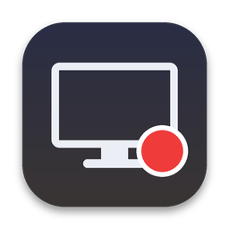

<div align="center">



# SRM Recorder for Mac

**SRM Recorder is a free, lightweight screen recorder for Mac. Record your screen with system audio and your voice.**

<sub>Formerly “SRM Recorder”. Same app, new name.</sub>

[](https://github.com/niruvai/srm-recorder/releases/latest)
&nbsp;

&nbsp;

&nbsp;
[](https://github.com/niruvai/srm-recorder/releases)

**[⬇️ Download the latest version](https://github.com/niruvai/srm-recorder/releases/latest)**

</div>

---

## 🎬 What is SRM Recorder?

**SRM Recorder** is a native screen recorder for macOS that records the Mac's own sound, which the built-in recorder can't do, along with your voice from a microphone. It's about 1.3 MB, needs no drivers or extra software, and is free.

🌐 **Official page:** [nirobislam.com/shop/srm-recorder](https://www.nirobislam.com/shop/srm-recorder) · 📖 [Read the full introduction](https://www.nirobislam.com/blog/srm-recorder-mac)

## ✨ Features

| | |
|---|---|
| 🖥️ **Three capture modes** | Full screen (any display), a single window, or an area you drag to select |
| 🔊 **System audio** | Record the sound playing on your Mac. You can turn it on or off. |
| 🎙️ **Microphone** | Record your voice and choose the input device. A live level meter shows while you record. |
| 🎚️ **Mixed audio track** | System audio and your voice are mixed into one track, so the file plays everywhere |
| 🟥 **Recording frame** | A red frame shows exactly what is being recorded. It never appears in the video. |
| ⏯️ **Floating controls** | A timer with Pause/Resume and Stop sits next to the recorded area |
| ⏱️ **Countdown** | 3, 5 or 10 seconds before recording starts |
| ⌨️ **Global shortcuts** | **⌥⌘R** start / stop, **⌥⌘P** pause / resume. They work in any app. |
| 📊 **Menu bar** | Live timer and full control from the menu bar |
| 🎞️ **Quality options** | MP4 / MOV · H.264 / HEVC · 24 / 30 / 60 fps · Retina or 1x |
| 📚 **Library** | Thumbnails, duration, play, rename, Show in Finder, Move to Trash |
| 🔄 **Automatic updates** | When a new version is released, the app offers to install it for you |
| 🪶 **Tiny & native** | About 1.3 MB. Universal build for Apple Silicon and Intel. No extra software needed. |

## 📥 Install

1. Download **`SRMRecorder-x.y.z.dmg`** from the [latest release](https://github.com/niruvai/srm-recorder/releases/latest).
2. Open the DMG and drag **SRM Recorder** into **Applications**.
3. **The first time you open it:** right-click the app and choose **Open**. On macOS 15 and later, go to **System Settings → Privacy & Security** and click **Open Anyway**.
   <sub>macOS asks this once because the app is not distributed through the Mac App Store.</sub>
4. Allow **Screen Recording** when asked (System Settings → Privacy & Security → Screen & System Audio Recording), then click **Quit & Reopen** in the app.

You don't need to install anything else. Everything the app uses is already part of macOS.

## ⌨️ Shortcuts

| Action | Shortcut |
|---|---|
| Start / Stop recording | **⌥ ⌘ R** |
| Pause / Resume | **⌥ ⌘ P** |
| Area selection: confirm / whole screen | **Return** |
| Area selection: cancel | **Esc** |

## ❓ FAQ

<details>
<summary><b>The app says “Screen Recording permission needed”</b></summary>

Turn on **SRM Recorder** in System Settings → Privacy & Security → Screen & System Audio Recording, then click **Quit & Reopen** in the app. If an old entry is stuck, run this in Terminal, then reopen the app and allow it again:

```
tccutil reset ScreenCapture com.local.ScreenRecorder
```
</details>

<details>
<summary><b>Where are my recordings saved?</b></summary>

By default in `~/Movies/Screen Recordings`. You can change the folder in **Settings → General**.
</details>

<details>
<summary><b>How do updates work?</b></summary>

The app checks for a new version when it starts and every few hours. When one is available, click **Install & Relaunch**. You can also choose **Check for Updates…** from the menu bar icon, or turn automatic checks off in Settings.
</details>

<details>
<summary><b>Some players only play the microphone / system audio</b></summary>

Keep **Settings → Video & Audio → “Mix system audio and microphone into one track”** turned on (the default).
</details>

## 🐞 Feedback & support

Found a bug or have an idea? [Open an issue](https://github.com/niruvai/srm-recorder/issues) or email **[nirob@nirobislam.com](mailto:nirob@nirobislam.com)**.

## 👨‍💻 Developer

<table>
<tr>
<td>

**Md. Nurunnabi Islam Nirob** (Niru Bhai)<br>
Web Developer & Video Editor, Bogura, Bangladesh

🌐 [nirobislam.com](https://nirobislam.com) &nbsp;·&nbsp;
✉️ [nirob@nirobislam.com](mailto:nirob@nirobislam.com) &nbsp;·&nbsp;
📘 [Facebook](https://www.facebook.com/mdnurunnabiislamniroob) &nbsp;·&nbsp;
💬 [WhatsApp](https://wa.me/8801742851043) &nbsp;·&nbsp;
▶️ [YouTube](https://www.youtube.com/@mdnurunnabiislamnirob) &nbsp;·&nbsp;
💼 [LinkedIn](https://www.linkedin.com/in/md-nurunnabi-islam-nirob-941848213) &nbsp;·&nbsp;
📸 [Instagram](https://www.instagram.com/niru_bhai_0) &nbsp;·&nbsp;
𝕏 [@nirob_islambd](https://x.com/nirob_islambd)

</td>
</tr>
</table>

---

<div align="center">
<sub>© 2026 Md. Nurunnabi Islam Nirob. SRM Recorder is free to download and use. All rights reserved.</sub>
</div>
